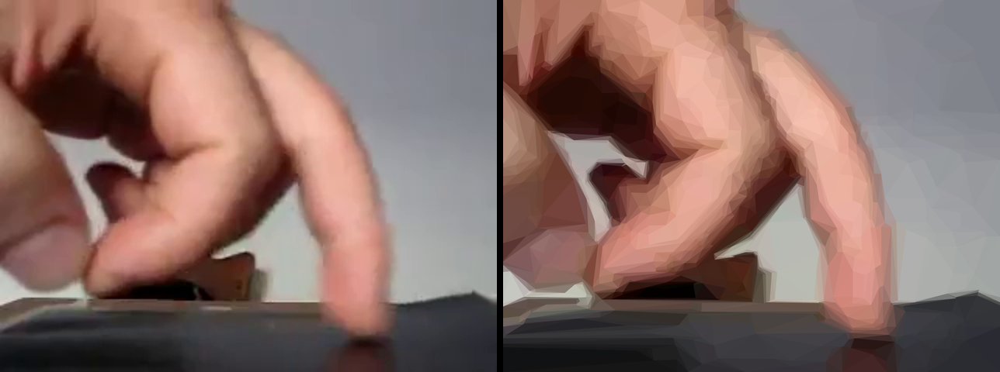
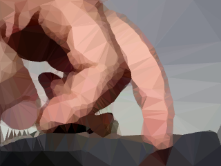
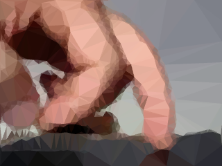
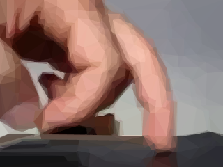
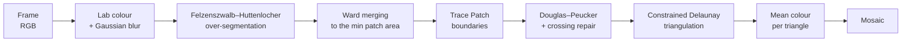

<div align="center">

# hipsterismo

**Turn a video, a webcam or your phone's camera into low-poly art, live.**

[](https://github.com/spippoli/hipsterismo/releases/latest)
[](https://github.com/spippoli/hipsterismo/releases)
[](https://github.com/spippoli/hipsterismo/actions/workflows/android-master.yml)
[](https://github.com/spippoli/hipsterismo/actions/workflows/android-release.yml)
<br>
[](https://openframeworks.cc/)
[](src/mosaic/core/)
[](android/)
[](android/INSTALL.md)
[](https://github.com/spippoli/hipsterismo/commits/master)
[](https://github.com/spippoli/hipsterismo/issues)



[**Download the Android app**](https://github.com/spippoli/hipsterismo/releases/latest) ·
[Install guide](android/INSTALL.md) ·
[Build the desktop app](#desktop-app-openframeworks) ·
[How it works](#how-it-works) ·
[Report a bug](https://github.com/spippoli/hipsterismo/issues/new)

</div>

---

hipsterismo splits every image into **Patches** of similar colour, triangulates them so that no triangle crosses two Patches, and paints each triangle with the mean colour beneath it. The result, a **Mosaic** of flat-coloured **Tessels**, keeps the shapes of the scene and drops the detail. It runs in real time on a 320×240 camera feed and turns full-resolution photos into Mosaics in about a second.

It comes in two flavours that share the same C++ core:

| | **Android app** | **Desktop app** |
|---|---|---|
| Input | Live camera, photos, gallery | `fingers.mov`, webcam, still images |
| Output | Live preview, PNG saved to the gallery or shared | Window, PNG from the command line |
| Built with | Kotlin, Jetpack Compose, CameraX, JNI | openFrameworks 0.12, OpenCV |
| Get it | [Releases](https://github.com/spippoli/hipsterismo/releases/latest) | [Build from source](#desktop-app-openframeworks) |

## Features

- 🎥 **Live Mosaic** of the camera at about 30 fps on a Pixel 8a, with front and back camera, zoom chips and pinch to zoom.
- 📸 **Photos to Mosaics** from the shutter or the gallery, up to 2048 px on the long side, usually in about one second.
- 🎚️ **One knob**, the *min patch area* (Grain): from fine 8 px² Patches to bold 1024 px² ones, with the same look at any resolution.
- 💾 **Save and share** the Mosaic as a PNG with no EXIF data: no location, no camera details.
- 🧭 **Three vertex modes** on the desktop: *adaptive* (Patches, the default), *stable* (grid cells, steady under camera noise) and *spline* (the original look).
- 🖼️ **Command-line still mode** to batch-convert images.
- 🎯 **Deterministic**: the same Frame gives bit-identical Mosaics with GCC and Clang, on x86-64 and arm64, checked by golden hashes in CI.
- 🌍 English and Italian.

## Vertex modes

| Spline | Stable | Adaptive (default) |
|:---:|:---:|:---:|
|  |  |  |
| Contour points resampled along one spline. Vertices move with every bit of noise. | One vertex per grid cell a Contour crosses, kept for a few Frames. Steady under noise. | Triangles follow the Patch boundaries exactly, each filled with its mean colour. |

## Android app

> [!NOTE]
> The app isn't on the Play Store. Each [release](https://github.com/spippoli/hipsterismo/releases/latest) has a signed APK and its SHA-256. It needs **Android 10 or later on an arm64 phone** and asks for one permission, the camera. Pictures never leave the phone unless you share them.

1. Download `hipsterismo-X.Y.Z.apk` from the [latest release](https://github.com/spippoli/hipsterismo/releases/latest) in Chrome.
2. Allow *Install unknown apps* for Chrome when Android asks.
3. If Play Protect warns about an unknown developer, tap *More details* → *Install anyway*.
4. Open **Hipsterismo** and allow the camera.

The full guide, in Italian and English, is in [`android/INSTALL.md`](android/INSTALL.md). It ends with a **5-minute check**: if you try the app on a phone that isn't listed in [`android/DEVICES.md`](android/DEVICES.md), long-press the **LIVE** chip to share the diagnostic report and [open a *Tested phone* issue](https://github.com/spippoli/hipsterismo/issues/new?template=tested-phone.yml). The report holds no personal data.

<details>
<summary><b>Building the Android app from source</b></summary>

Requirements: JDK 21, the Android SDK with NDK r30 (`30.0.16248370`) and CMake 3.31.6. The Gradle wrapper is checked in.

```sh
export JAVA_HOME=/path/to/jdk-21 ANDROID_HOME=/path/to/Android/Sdk
cd android
./gradlew assembleDebug                     # app/build/outputs/apk/debug/app-debug.apk
$ANDROID_HOME/platform-tools/adb install -r app/build/outputs/apk/debug/app-debug.apk
./gradlew test                              # JVM unit tests
./gradlew connectedDebugAndroidTest         # instrumented tests on a phone or emulator
```

The debug build installs as **Hipsterismo debug** (`io.github.spippoli.hipsterismo.debug`), next to a release install. A signed release build reads its keystore from four environment variables; see [`CLAUDE.md`](CLAUDE.md#android-app) for the release build, the CI workflows and how a release is cut.

</details>

## Desktop app (openFrameworks)

### Requirements

- [openFrameworks 0.12.x](https://openframeworks.cc/download/), built for your platform (tested on Linux with OpenCV 4 and C++20)
- These addons in `<OF_ROOT>/addons/`: **ofxCv**, **ofxDelaunay** (patched, see below), **ofxGui**, **ofxMSACore**, **ofxMSAInterpolator**, **ofxOpenCv**, **ofxXmlSettings**

Only ofxGui, ofxOpenCv and ofxXmlSettings ship with openFrameworks. Clone the others and apply the triangulation fix:

```sh
cd <OF_ROOT>/addons
git clone https://github.com/kylemcdonald/ofxCv.git
git clone https://github.com/obviousjim/ofxDelaunay.git
git clone https://github.com/memo/ofxMSACore.git
git clone https://github.com/memo/ofxMSAInterpolator.git
git -C ofxDelaunay apply <OF_ROOT>/apps/myApps/hipsterismo/patches/ofxDelaunay-hull-triangles.patch
```

> [!IMPORTANT]
> The [patch](patches/ofxDelaunay-hull-triangles.patch) makes ofxDelaunay's in-circle tests exact. Without it, triangles can overlap or leave holes, and the tests fail.

### Build and run

The project must live at `<OF_ROOT>/apps/myApps/hipsterismo`, because the `Makefile` finds openFrameworks at `../../..`.

```sh
cd <OF_ROOT>/apps/myApps
git clone https://github.com/spippoli/hipsterismo.git
cd hipsterismo
make Release
make run
```

For Xcode, Visual Studio or VS Code, import the folder with the openFrameworks **projectGenerator**: it reads `addons.make`.

The app plays `bin/data/fingers.mov`. To use the webcam (320×240, mirrored), uncomment `#define LIVE_INPUT` in [`src/ofApp.h`](src/ofApp.h) and rebuild.

### Keyboard

| Key | Action |
|:---:|---|
| <kbd>s</kbd> | Cycle the vertex mode: spline → stable → adaptive |
| <kbd>g</kbd> | Show or hide the settings panel and the fps |
| <kbd>h</kbd> | Switch between the Mosaic and the source |
| <kbd>c</kbd> | Contour overlay |
| <kbd>d</kbd> | Triangle wireframe overlay |
| <kbd>f</kbd> | Fullscreen |
| <kbd>p</kbd> | Save a screenshot to `bin/data/screenshot.png` |

Settings live in `bin/data/settings.xml`; use the panel's save and load buttons to keep them.

### Still images from the command line

```sh
bin/hipsterismo photo.jpg                        # writes photo-mosaic.png next to it
bin/hipsterismo photo.jpg result.png             # writes result.png
bin/hipsterismo --mode stable photo.jpg          # spline | stable | adaptive
bin/hipsterismo --help
```

The Mosaic is rendered at the image's own size, with the parameters from `settings.xml`. No window shows, but a display is still needed for the OpenGL context. Exit code: `0` on success, `1` if the image can't be read or written, `2` on bad arguments.

## How it works

The adaptive pipeline lives in [`src/mosaic/core/`](src/mosaic/core/): plain C++ with no openFrameworks, OpenCV or glm, so the Android app needs nothing but the NDK.



1. **Lab and blur.** The Frame goes to CIE Lab, bit-for-bit like OpenCV's float conversion, and gets a light Gaussian blur.
2. **Patches.** Felzenszwalb–Huttenlocher over-segments the image; Ward merging then joins the cheapest neighbours until every Patch reaches the *min patch area*, and every Patch ends up 4-connected.
3. **Boundaries.** The Patch borders are traced on the lattice of pixel corners, simplified with Douglas–Peucker, and repaired until no two segments cross.
4. **Triangles.** A constrained Delaunay triangulation ([CDT](https://github.com/artem-ogre/CDT)) uses the borders as edges, so no triangle crosses two Patches.
5. **Colour.** Each triangle takes the mean colour of the pixels inside it.

Every size is defined at 320×240 and scaled to the Frame, so a 12 MP photo looks like the live preview. Photo-sized Frames split the per-pixel steps across threads without changing a single bit of the output.

The words used here (Frame, Patch, Contour, Tessel, Mosaic, Grain) are defined in [`GLOSSARY.md`](GLOSSARY.md).

## Tests

| Suite | Command | What it checks |
|---|---|---|
| Core (CMake, no OF) | `cmake -S tests/core -B tests/core/build && cmake --build tests/core/build -j && tests/core/build/core_tests` | Tiling, Patch connectivity, golden hashes of the fixtures |
| openFrameworks | `make -C tests && make -C tests run` | All three modes, the Lab port against OpenCV, the CLI parser |
| Android JVM | `cd android && ./gradlew test` | Camera maths, photo sizes, diagnostics |
| Android device | `cd android && ./gradlew connectedDebugAndroidTest` | JNI, decoding, drawing, export |
| Core on a phone | `android/scripts/core-on-device.sh` | Same hashes on arm64 as on the desktop |

Each test command exits with the number of failures. CI runs the Android suite on emulators from API 30 to 37 before each release.

## Contributing

Bugs and ideas go to [GitHub Issues](https://github.com/spippoli/hipsterismo/issues). Pull requests are welcome:

- branch from `master` with a `feat/…`, `fix/…`, `docs/…` or `chore/…` name;
- write [Conventional Commits](https://www.conventionalcommits.org/) (`feat(android): …`);
- describe what changed, why and how you tested it, and link the issue (`Closes #N`).

Changes to `src/mosaic/core/` must keep the golden hashes: run the core tests with GCC and Clang. [`CLAUDE.md`](CLAUDE.md) has the full architecture and build notes.

## Acknowledgements

- [openFrameworks](https://openframeworks.cc/) and the addons [ofxCv](https://github.com/kylemcdonald/ofxCv), [ofxDelaunay](https://github.com/obviousjim/ofxDelaunay) and [ofxMSAInterpolator](https://github.com/memo/ofxMSAInterpolator)
- [CDT](https://github.com/artem-ogre/CDT) by Artem Amirkhanov (MPL-2.0), vendored unmodified in [`src/mosaic/CDT/`](src/mosaic/CDT/)
- [OpenCV](https://opencv.org/), whose sRGB→Lab table (Apache-2.0) the core reproduces exactly
- P. Felzenszwalb and D. Huttenlocher, [*Efficient Graph-Based Image Segmentation*](https://cs.brown.edu/people/pfelzens/segment/), IJCV 2004
